# Pokémon Adamant Diamond & Lustrous Pearl

Sinnoh's Diamond, Pearl and Platinum rebuilt inside Pokémon Black 2, in the Gen 5 style: Lustrous Pearl and Adamant
Diamond (version 1.0.1) and Griseous Platinum (version 1.0). Releases are `.bps` patches only; no ROMs are ever
included.

## Playing it
1. Get a clean **Pokémon Black 2 (USA)** ROM from your own cartridge (game code IREO, CRC32 D4427FD1).
2. Apply the release's `.bps` patch for the version you want with a BPS patcher (Floating IPS, Rom Patcher JS), on a
   computer: a 512 MB game is too much for a phone browser.
3. Play it in melonDS or on hardware. DeSmuME hides some bugs that melonDS and hardware show.

## Lustrous Pearl and Adamant Diamond: 1.0.1
- **Story:** the whole story, from Twinleaf to the Hall of Fame, with Palkia in Lustrous Pearl and Dialga in Adamant
  Diamond, each with its version's wild Pokémon, Orb, title screen and Pokédex entries. Post-game: the National
  Pokédex at Champion, the Battle Zone with the Battle Tower and the PWT, Stark Mountain, Snowpoint Temple, Turnback
  Cave, Fullmoon and Newmoon Islands, and the event Pokémon (Darkrai, Shaymin, Arceus, the Manaphy Egg) from the
  Poké Mart deliveryman.
- **Features:** Super Contests (Visual, Dance, Acting) with Accessories and Poffins; Secret Bases; the Grand
  Underground with wandering Pokémon; the Pokétch; Pal Park with BDSP's Ramanas Park rooms; roaming Mesprit and
  Cresselia; following Pokémon; seasons; TMs, HMs, Rock Climb and Defog.
- **Known issues:** in Super Contests, hearts, Voltage and result bars are numbers rather than the original sprites,
  the top screen shows numbers instead of the dressed Pokémon during Visual, and the curtain doesn't count in Visual's
  score. Black 2's sounds stand in for the contests' and the Digger Drill's. Cooking Poffins is solo, with simplified
  art. Secret Bases have no Radar or other players' bases, and a placed good can wall you in, as in the original: Move
  Goods frees you.
- **New in 1.0.1:** after the Hall of Fame every Pokémon can be caught in either version. The fossil restorer, the
  in-game trades, the Move Deleter and the ribbon givers work, and the Game Corner's prizes are sold at the Veilstone
  Department Store. Many bugs and map fixes: see [Known issues](docs/known-issues.md#fixed-in-101).
- **Not in yet:** digging in the Underground; the Game Corner's slots; Jubilife TV's Loto, Route 222's size contest and
  Vista Lighthouse's binoculars; online features. Pal Park's migration from a GBA game is in the build but unconfirmed.
  The full list is in [Known issues](docs/known-issues.md).

## Griseous Platinum: 1.0
- **Story:** Platinum's story from Twinleaf to the Hall of Fame, with its changed towns, routes, Gyms and trainers,
  its own Lucas and Dawn, Giratina and the Griseous Orb.
- **The Distortion World:** walk on its walls and ceilings, ride its moving platforms, solve the boulder puzzle with
  the lake trio, and face Giratina.
- **Post-game:** the Battle Frontier (the Battle Tower, Factory, Hall, Castle and Arcade) with its Frontier Brains,
  Stark Mountain, the Villa, and Regigigas from the Poké Mart deliveryman.
- Everything from Lustrous Pearl's 1.0.1 that Platinum has: Super Contests, Secret Bases, the Grand Underground, the
  Pokétch, Pal Park's rooms, following Pokémon and seasons.
- **Not as in Platinum:** online features and the Global Terminal's upper floors are closed, and so is the Game
  Corner (its prizes are sold at the Veilstone Department Store). The Frontier has no Vs. Recorder, and its picture
  rooms have no moving floors, lights or particles. The player guide covers Lustrous Pearl and Adamant Diamond only.

Please report bugs: these are big games, and some parts have been tested only in an emulator.

## Player guide
The [player guide](docs/README.md) lists each version's wild Pokémon, item locations, important trainers and post-game,
plus Pal Park's rooms, the Underground, Secret Bases, Super Contests, Poffins, the Pokétch, TMs and more. It's made from
the game's own data.

## Screenshots
### Griseous Platinum
| | |
|---|---|
| 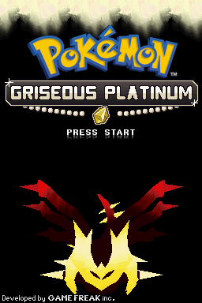 | Griseous Platinum, with Giratina |
| 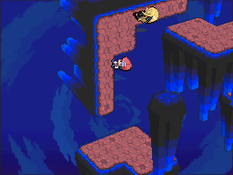 | The Distortion World: walking on a wall, with Cynthia on it too |
| 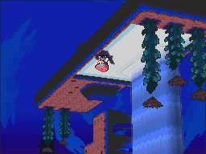 | The Distortion World: upside down on B4F's ceiling, beside its waterfall |
| 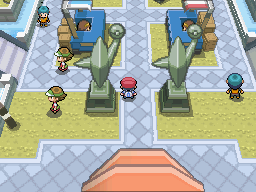 | The Battle Frontier |
| 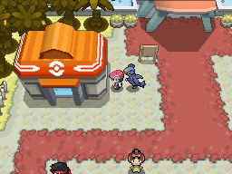 | The Fight Area in autumn, with a following Garchomp |

### Lustrous Pearl and Adamant Diamond
| | |
|---|---|
| 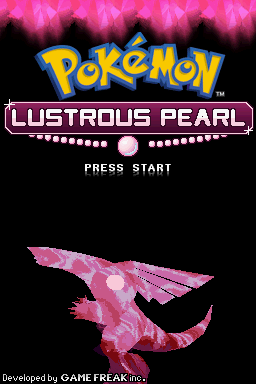 | Lustrous Pearl |
| 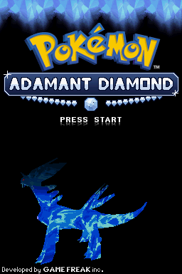 | Adamant Diamond |
| 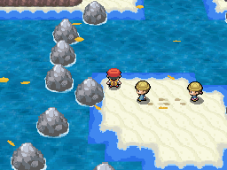 | Black 2's animated sea on Route 219 |
| 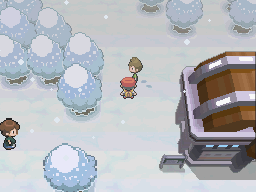 | Snowpoint City in winter |
| 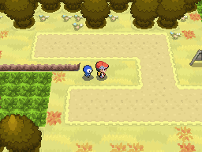 | Following Pokémon on Route 201 in autumn |
| 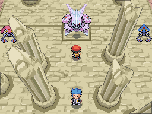 | Spear Pillar in Lustrous Pearl |
| 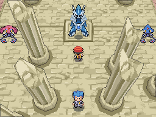 | Spear Pillar in Adamant Diamond |
| 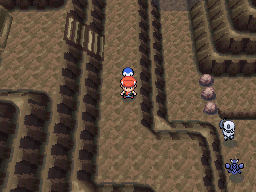 | The Grand Underground: Pokémon wandering in a Hideaway |
| 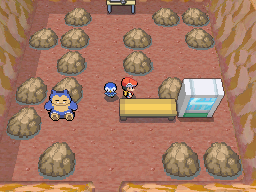 | A decorated Secret Base |
| 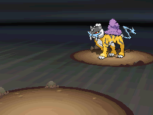 | Meeting Raikou in Adamant Diamond's Johto Room |
|  | Weather: Route 210's fog, then cleared with Defog |
|  | Route 201 in summer and autumn |
|  | Hidden Grottos and the Hideaways |
|  | Placing the Oceanic Slate: Kyogre appears |
|  | Sinnoh's place names on arrival |

## For developers
- Start with `notes/START_HERE.md` (open decisions and status), then `notes/PLAN.md` (feasibility and phases).
- `notes/SETUP.md`: what is in this repo, where each tool came from, how to set up.
- `notes/DECISIONS.md`: every decision, dated, with who made it.
- The game's C changes live in a branch of the pokebw2 decomp (`pearlb2`), not published yet.

This project is built with the help of AI coding tools (Anthropic's Claude).

## Credits
- Pokémon Pearl and Pokémon Black 2: Game Freak, Nintendo, The Pokémon Company. This is a fan project.
- The player's battle back as Lucas: "Trainer Lucas back BW style" by tebited15 (DeviantArt, free use;
  `art_sources/fan_tebited15_lucas_back/CREDIT.txt`).
- The Pokémon Black 2 decompilation (pokebw2) and the Diamond/Pearl and Platinum decompilations (pokediamond,
  pokeplatinum), which this work reads.
